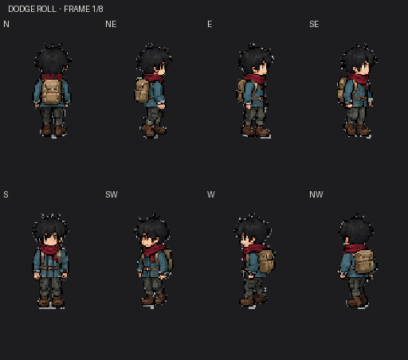
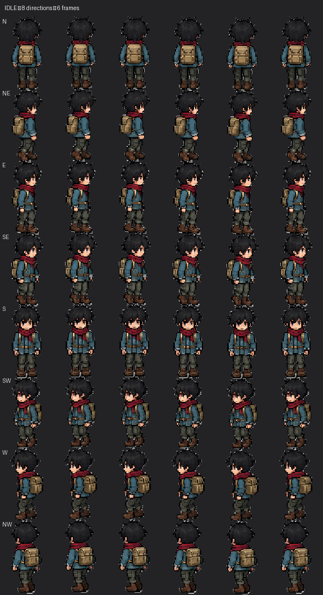
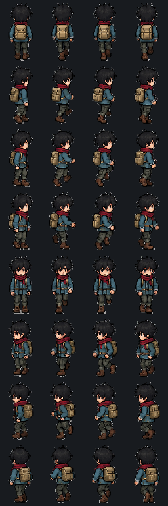
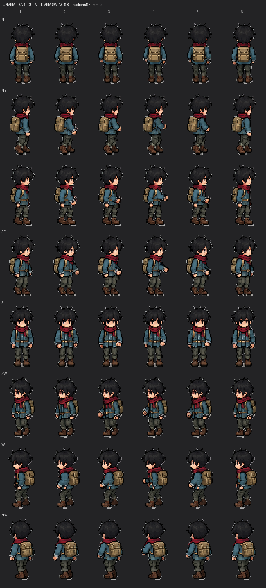
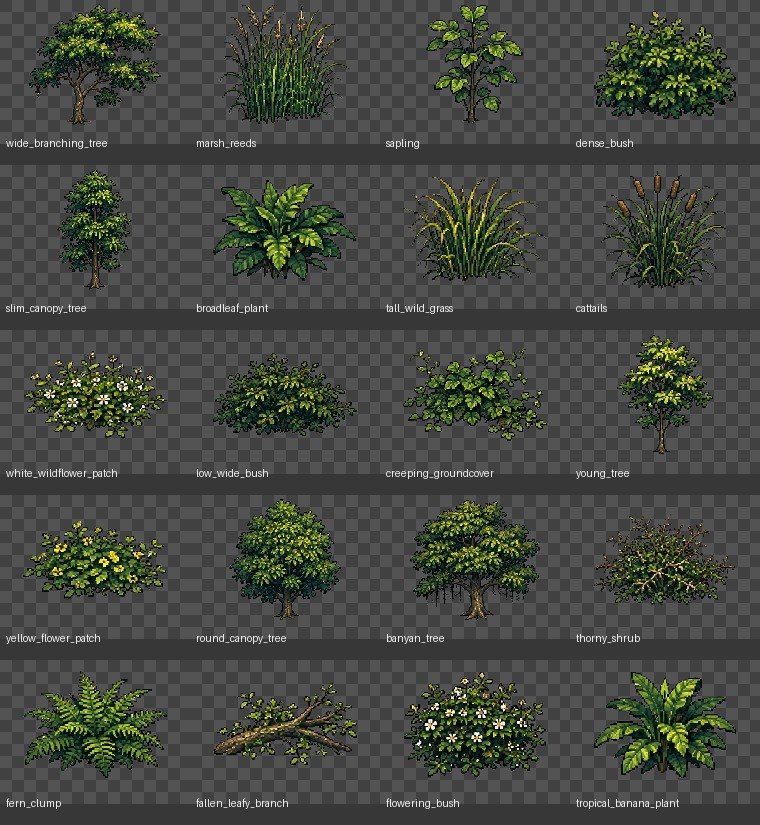
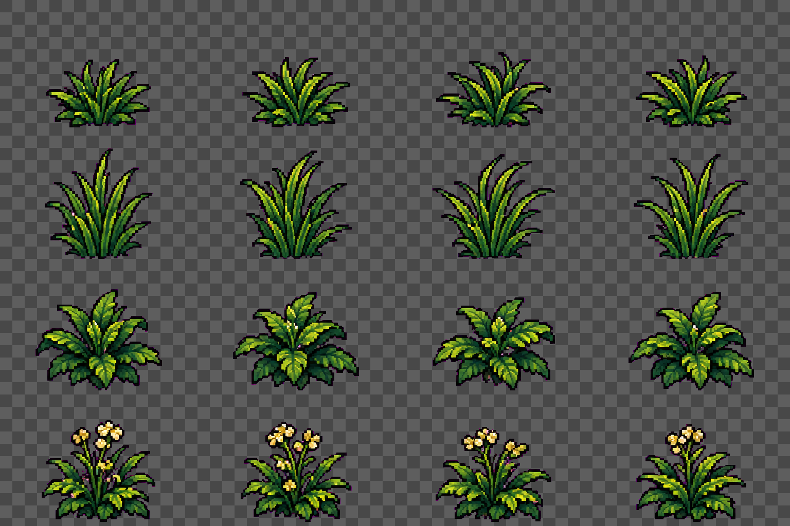
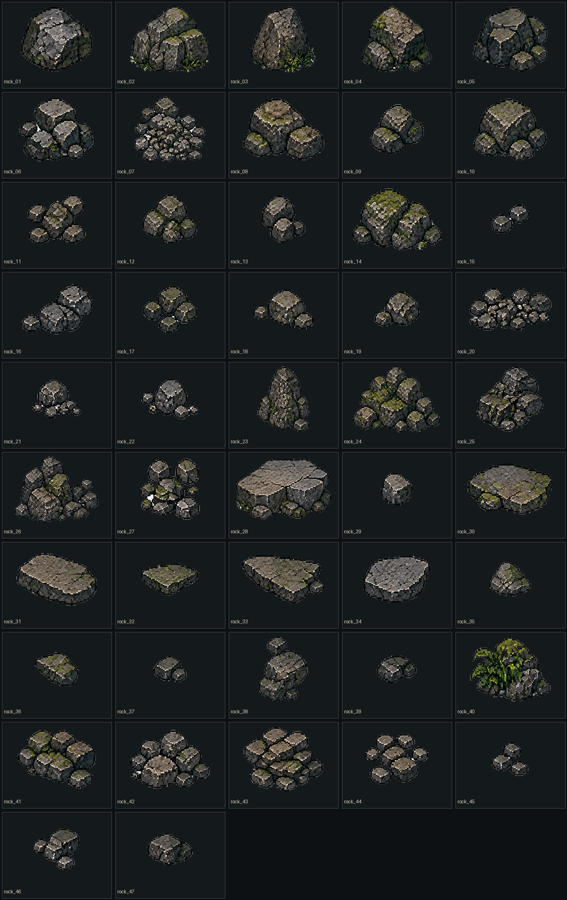
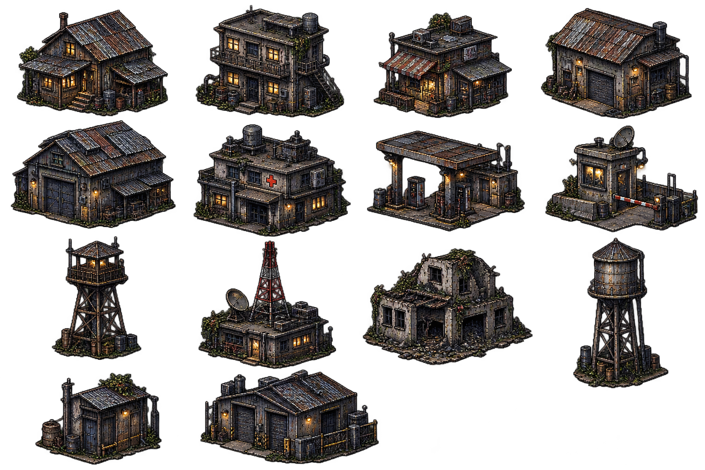
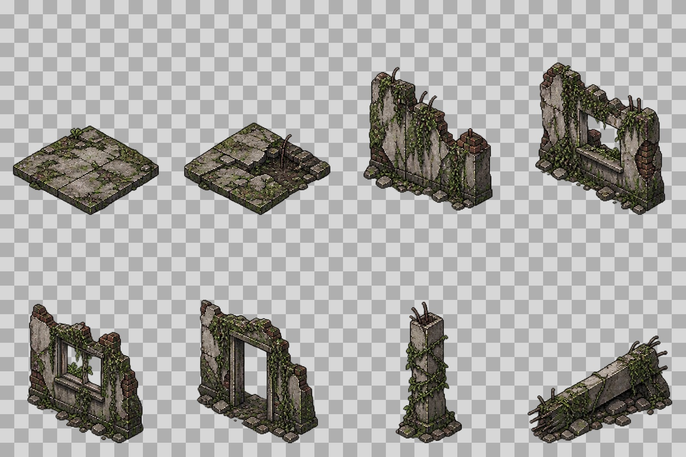
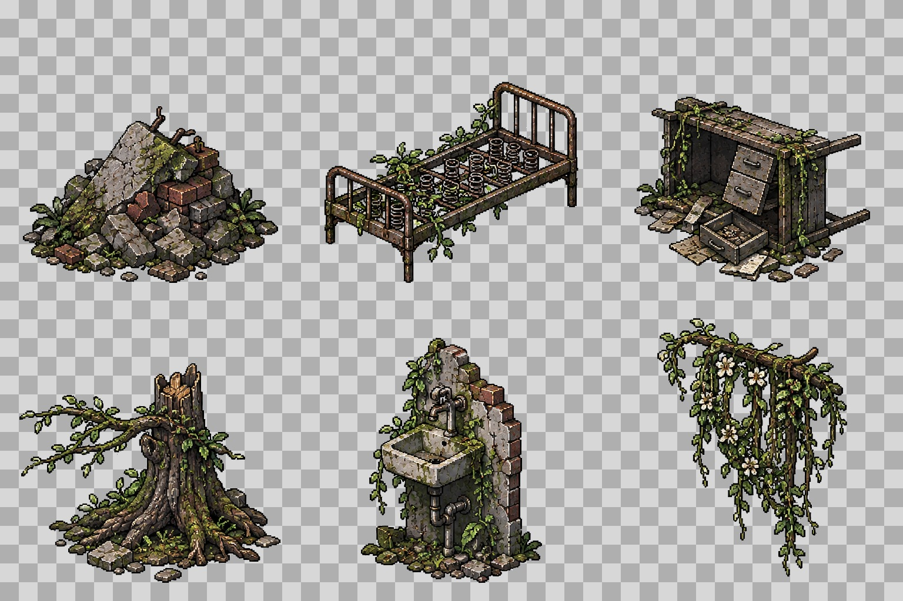

<div align="center">

# DRIFTER'S TALE

### CYGNUS SIGNAL SERIES · FIELD BUILD 01

* A quiet station. A road sealed at both ends. A signal that keeps answering. *

[](https://drifter-tale.vercel.app)
[](https://threejs.org/)
[](https://vercel.com/)

<br>

**[▶ PLAY THE LIVE FIELD BUILD](https://drifter-tale.vercel.app)**

<sub>WNCORE STATION 01 &nbsp;·&nbsp; 88.7 FM &nbsp;·&nbsp; SIGNAL STATUS: RECEIVING</sub>

<br>



<sub>CHARACTER MOTION STUDY · SPRITE ANIMATION PREVIEW</sub>

</div>

---

> **WNCORE CONTINUITY — 88.7 FM**
>
> *The signal reaches those who are still listening.*

## ▸ THE FIELD

**Drifter's Tale** is an atmospheric, isometric HD-2D exploration game set at WNCORE Station 01, inside the **Cygnus Signal Series** universe.

Walk the station grounds. Look inside the buildings. Read the traces people left behind. Follow the road into Silvan, listen to the radio, and work out why the station is still transmitting.

This is an actively developed **playable field build**. The focus is exploration, environmental storytelling, atmosphere, and building a world that feels like it existed before the player arrived.

## ▸ VISUAL ARCHIVE

A look at the characters, environments, and sprite libraries behind the field build.

### Character animation

<div align="center">
  
  &nbsp;&nbsp;
  
  &nbsp;&nbsp;
  
</div>

<div align="center">
  <sub>IDLE</sub> &nbsp;&nbsp;&nbsp;&nbsp;&nbsp;&nbsp;&nbsp;&nbsp; <sub>8-DIRECTION WALK</sub> &nbsp;&nbsp;&nbsp;&nbsp;&nbsp;&nbsp;&nbsp;&nbsp; <sub>SWING</sub>
</div>

### Environment and world assets

<table>
  <tr>
    <td align="center" width="50%">
      
      <br><sub>FOLIAGE LIBRARY</sub>
    </td>
    <td align="center" width="50%">
      
      <br><sub>WIND-ANIMATED GRASS</sub>
    </td>
  </tr>
  <tr>
    <td align="center" width="50%">
      
      <br><sub>ROCK & STONE LIBRARY</sub>
    </td>
    <td align="center" width="50%">
      
      <br><sub>BUILDING SPRITE LIBRARY</sub>
    </td>
  </tr>
</table>

<details>
  <summary><b>More location and interior assets</b></summary>
  <br>
  <div align="center">
    
    
    <br><sub>COLLAPSED BUILDING · SHELL AND PROPS</sub>
  </div>
</details>

> **Gameplay footage:** The live build is playable at [drifter-tale.vercel.app](https://drifter-tale.vercel.app). A recorded in-game GIF or screenshot has not yet been added to the repository; the animated image above is a character-sprite preview, not a gameplay capture.

## ▸ WHAT YOU CAN EXPLORE

| LOCATION | TRANSMISSION NOTES |
| :--- | :--- |
| **WNCORE Station 01** | An isometric station grounds, relay mast, scattered buildings, roadblocks, and places worth investigating. |
| **Relay Tower** | Three cutaway rooms: Control, Equipment, and Briefing. Each has its own layout, lighting, props, and points of interest. |
| **Station Buildings** | Walk-in interiors for the utility shed, maintenance depot, water tower, watchtower, checkpoint booth, and collapsed building. |
| **Silvan** | A separate forest region with a winding river, three bridges, a trail, eight examinable landmarks, lanterns, sun shafts, and river ambience. |
| **???** (section 03) | A city with its name scraped off, reached by the unmarked road south of the east end of the station road. A shop street, fuel stop and market, supermarket, clinic, homes, an industrial yard and a square, with ten places to examine and six supplies. Exteriors only. |
| **The Grassland** | A meadow south of the station road, with four animated grass types and loose vegetation across the open ground. |

## ▸ SYSTEMS ONLINE

- **Isometric world:** A sprite-based world rendered with Three.js r128 and a shared isometric camera.
- **Environmental animation:** Grass cycles through sprite frames and responds to layered wind sway. Vegetation is flattened around the player to keep movement readable.
- **Walk-in interiors:** Room layouts use camera-facing sprites, dedicated collision, lighting, and interaction points.
- **Checkpoint gate:** A layered checkpoint scene separates the ground, booth, posts, and barrier arm; the gate has raised and lowered states.
- **Radio and discoveries:** Tune into WNCORE broadcasts, examine objects, and collect discoveries in the logbook.
- **Supplies and vitals:** Ten one-use supplies are placed in the relay tower and six in the ??? city. FOOD and WATER meters drain over time and warn when low.

<sub>Field note: low FOOD / WATER currently triggers warnings only. Survival consequences are not implemented yet.</sub>

## ▸ CONTROLS

### Keyboard

| KEY | ACTION |
| :--- | :--- |
| `W A S D` | Walk |
| `SHIFT` | Run |
| `SPACE` | Swing |
| `R` | Rest / stop |
| `E` | Examine / interact, eat, or drink |
| `TAB` | Open the logbook |
| `N` | Open the field compass and set a waypoint |
| `ESC` | Close the current panel |
| `M` | Mute / unmute audio |

### Touch

| GESTURE | ACTION |
| :--- | :--- |
| Drag the left side | Move |
| Drag farther | Run |
| Tap the right side | Examine / interact |
| Hold the right side | Swing |
| Double-tap the left side | Rest |
| Tap the top-right corner | Open the logbook |

Portrait mobile screens automatically zoom the camera in so the player stays visible.

## ▸ RUN THE STATION LOCALLY

There is no build step. The game uses JavaScript modules, so serve the repository through a local web server rather than opening the HTML file directly.

```bash
git clone https://github.com/Siharu/cygnus-project.git
cd cygnus-project
npx serve .
```

Then open the local address printed by the server (usually `http://localhost:3000`).

## ▸ PROJECT MAP

```text
cygnus-project/
├── index.html                  # Game entry point
├── vercel.json                 # Static deployment and routing
├── src/
│   ├── WNCORE_Station_01.html  # Original single-file build / reference
│   └── station/
│       ├── main.js             # Game loop, player, overworld, HUD, audio
│       ├── assets.js           # Runtime asset map
│       ├── meta.js              # Sprite metadata and world text
│       ├── style.css            # Overlay and interface styling
│       ├── checkpoint.js        # Checkpoint booth and barrier
│       ├── forest.js             # Silvan region
│       ├── grassland.js          # Wind-animated meadow
│       ├── interior.js           # Relay tower interior renderer
│       ├── interior_layout.js    # Relay tower room data
│       ├── interiors_hub.js      # Additional building interior renderer
│       ├── interiors_hub_layout.js # Additional room data
│       ├── props.js              # Supplies and FOOD / WATER values
│       ├── compass.js            # Field compass and waypoint marker
│       ├── city.js               # ??? city (built on first visit)
│       ├── city_layout.js        # ??? city placement and note text
│       ├── city_catalog.js       # Generated sprite measurements
│       └── city_shade.js         # Shadow and light retouching of the city art
├── assets/
│   ├── game/                    # Runtime-ready sprites and textures
│   ├── HUB/                     # Building and interior asset collections
│   └── ...                      # Source libraries, atlases, and animation packs
├── scripts/
│   ├── modularize.py            # Original modularisation helper
│   └── city_catalog.py          # Measures city art and angle corrections, paints the ??? sign
├── install_checkpoint.py        # Checkpoint installer
├── install_interiors.py         # Building-interior installer
├── process_city_assets.py       # City sprite processing utility
├── city_sizes.json              # Real-world size reference for city assets
├── CHANGELOG.md
└── LICENSE
```

## ▸ NEXT TRANSMISSIONS

The world is still being built. Current development targets include:

- Give low FOOD / WATER levels actual gameplay consequences.
- Add usable medical items, a battery, flashlight, handheld radio, and extinguisher.
- Place supplies and survival interactions in Silvan.
- Add walk-in interiors to the ??? city.
- Expand environmental storytelling and the places available to explore.

## ▸ DEPLOYMENT

The live field build is hosted as a static site on Vercel. The game is served from the repository root:

**[drifter-tale.vercel.app →](https://drifter-tale.vercel.app)**

The Vercel ignore file excludes Git metadata, legacy deployment material, and ZIP archives from the deployment upload. The source asset collections remain in the repository.

## ▸ LICENSE

Released under the MIT License. See [LICENSE](LICENSE).

---

<div align="center">

**CYGNUS SIGNAL SERIES**

*Somewhere, a receiver is still on.*

<sub>DRIFTER'S TALE · WNCORE STATION 01 · 88.7 FM</sub>

</div>
